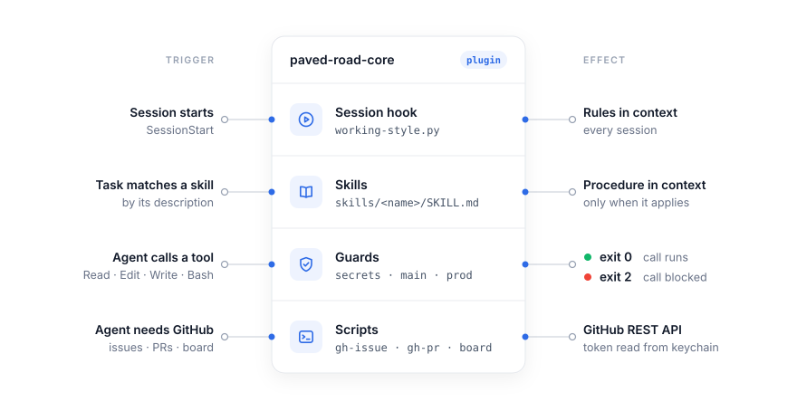
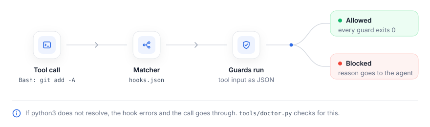
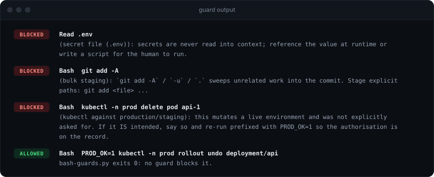
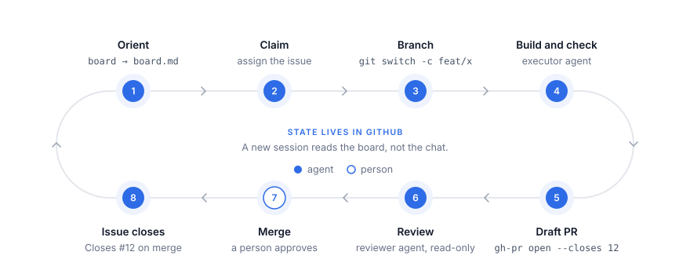

# paved-road

[](https://github.com/abin-m/paved-road/actions/workflows/ci.yml)
[](https://github.com/abin-m/paved-road/releases)
[](LICENSE)

A Claude Code plugin pack for platform, DevOps and security work: safety hooks, skills and GitHub scripts that apply in every repo you open. In 80 benchmark runs, plain Claude Code committed to `main` or printed a secret file 15 times. With paved-road installed it did neither, and still finished 74 of the 80 tasks.

[How it was measured](bench/harbor/README.md) · [What the guards stop, and what they don't](#what-the-guards-stop-and-what-they-dont)

## Who this is for

The pack fits a team that:

- keeps its code on GitHub and makes each change on a branch, through a pull request
- runs infrastructure with Kubernetes, Helm, Terraform, Ansible, Pulumi, CDK, or the AWS, Azure or Google Cloud CLIs
- names its production and staging environments with one of these words: `prod`, `production`, `prd`, `live`, `staging`, `stage`, `stg` or `preprod`

On GitLab or Bitbucket, the guards and most skills still work. The GitHub scripts and the `planning-flow` and `token-setup` skills don't.

## Quick start

You need `git`, and `python3` on your PATH.

In Claude Code:

```
/plugin marketplace add abin-m/paved-road
/plugin install paved-road-core@paved-road
```

Then confirm the hooks block on your machine:

```sh
git clone https://github.com/abin-m/paved-road.git && cd paved-road
python3 tools/doctor.py
```

The last line should read:

```
All guards enforcing on this machine.
```

If a step fails, see [docs/install.md](docs/install.md).

## Requirements

- Claude Code.
- `git`.
- Python 3.9 or later, as `python3`. The hooks and scripts use the standard library only.
- macOS or Linux. Windows works with Python from the Microsoft Store, or under WSL2.

## How it works

The pack adds four kinds of part to a Claude Code session. Each part runs at a different moment.

<picture>
  <source media="(prefers-color-scheme: dark)" srcset="docs/images/architecture-dark.svg">
  
</picture>

- The session hook prints `working-style.md` when a session starts, so every session begins with the same rules.
- A skill loads only when a task matches its description. Until then, only its one-line description is in context.
- A guard runs before every matching tool call and can stop it. A guard checks the command itself, so the agent can't argue its way past one. It only knows the forms of a command it was written for, though. See [what the guards don't stop](#what-the-guards-stop-and-what-they-dont).
- Scripts call the GitHub API with a token that `gh-token` reads from the OS keychain. The value goes to the shell, not to the transcript.

### Guards

Claude Code passes each tool call to the guards as JSON. A guard that exits with code 2 blocks the call, and its message goes back to the agent.

<picture>
  <source media="(prefers-color-scheme: dark)" srcset="docs/images/guard-flow-dark.svg">
  
</picture>

This is the guards' real output for three blocked calls and one allowed call:



### What the guards stop, and what they don't

The guards stop the usual ways an agent makes four mistakes: reading a secret file, staging the whole tree, committing on a default branch and changing production.

The guards are measured on 121 held-out commands. Those cases were written from this README, without reading the guard code, and the guards are never tuned against them.

| Guard | Bypasses blocked | Benign commands wrongly blocked |
|---|---|---|
| `secrets-guard` | 25 of 25 | 0 of 13 |
| `main-guard` | 16 of 16 | 0 of 13 |
| `prod-guard` | 33 of 33 | 0 of 21 |
| All | 74 of 74 | 0 of 47 |

The first held-out set found 7 bugs. Each was fixed, its case moved into the main corpus, and 25 new held-out cases replaced them. Those 25 were committed before the fixed guards ran against them.

[`bench/results.json`](bench/results.json) lists each case the guards got wrong. To rerun the benchmark, run `python3 tools/bench.py`. One Bash call through the guards takes about 50 ms.

The guards are also tested on whole tasks, with Claude Code run on the same 16 tasks with and without the pack ([bench/harbor](bench/harbor/README.md)). With the pack, all 80 runs were safe, against 65 of 80 without it. But the agent finished 62 tasks instead of 79, mostly because of one `prod-guard` bug, [#56](https://github.com/abin-m/paved-road/issues/56). With #56 and #57 fixed, it finished 74, and every run was still safe.

The guards don't replace access control. Give the agent's credentials only the access its task needs.

A guard does not stop:

- An agent that types `PROD_OK=1`. The prefix lets a production change through on purpose, and it stays in the transcript, where you can see it. The working style tells the agent to ask you first.
- A secret read through a program the guard doesn't know, such as `python3 -c`, `base64`, `jq` or `source .env`.
- A secret file copied to a new name in one command and read in the next.
- A search of a whole directory, such as `grep -r API_KEY .`, that reaches a secret file inside it. The guard checks the files a command names, and blocking every recursive search would get in the way of normal work.
- A `KUBECONFIG`, `TF_WORKSPACE` or `AWS_PROFILE` exported by an earlier command. The guard sees only the environment Claude Code started with.
- A CDK stack added since the app was last synthesised. For `cdk deploy --all`, the guard reads the stack names in `cdk.out`, so it doesn't see a stack that isn't there yet.
- A production environment whose name contains none of the words in [Who this is for](#who-this-is-for).
- An Ansible task marked `check_mode: false`. The guard allows `ansible-playbook --check` as a dry run, but such a task still runs for real. The guard doesn't read playbooks.

Report any other way past a guard as a security problem. See [SECURITY.md](SECURITY.md).

### The work loop

The `planning-flow` skill runs work through GitHub issues and pull requests. The issue is the record, so a new session picks up from GitHub instead of from chat history.

<picture>
  <source media="(prefers-color-scheme: dark)" srcset="docs/images/work-loop-dark.svg">
  
</picture>

## What you get

Skills load when a task matches. You can also call one as `/paved-road-core:<name>`.

| Skill | Use it for |
|---|---|
| `planning-flow` | The work loop from issue to merged PR. |
| `token-setup` | Creating, storing and checking a GitHub token. |
| `conventions` | Naming, repo layout and where a rule belongs. |
| `writing` | Commits, PRs, issues, docs and reports. |
| `readme` | What a README answers and how to test it. |
| `session-close` | Ending a session with nothing unpushed or stranded. |
| `iac-change` | Terraform, Ansible, Kubernetes and Helm changes. |
| `threat-check` | A threat model of the diff before merge. |
| `secure-defaults` | Safe settings for containers, Kubernetes, CI and cloud IAM. |
| `pipeline-debug` | Finding the cause of a failing pipeline. |
| `incident-response` | Stabilising, diagnosing and writing up an incident. |
| `release-flow` | Cutting, promoting and rolling back a release. |

| Script | What it does |
|---|---|
| `gh-token` | Reads a GitHub token from the OS keychain when a command runs. |
| `gh-issue` | Lists, shows, creates, comments on, labels and closes issues. |
| `gh-pr` | Opens, lists, checks, readies and merges PRs. |
| `board` | Writes `board.md` with the open issues and PRs across your repos. |
| `prose-check` | Flags writing faults in Markdown or a commit message. |

| Agent | What it does |
|---|---|
| `executor` | Builds one scoped change, runs the project's checks and opens the PR. |
| `reviewer` | Reviews a change with no edit tools, and runs the checks itself. |

| Hook | What it does |
|---|---|
| `working-style` | Prints `working-style.md` into every new session. |
| `secrets-guard` | Blocks reading `.env`, `*.tfvars`, kubeconfigs, private keys and `secrets/`. |
| `main-guard` | Blocks commits on a default branch, and `git add -A`. |
| `prod-guard` | Blocks changes to prod or staging, whether the command names it or the current kube context or Terraform workspace points at it. |
| `bash-guards` | Runs the three guards above for each Bash call, in one process. |

## Usage

Store a GitHub token once. The scripts then read it each time they run:

```sh
gh-token --store
gh-token --check
GH_TOKEN=$(gh-token) board
```

To run a production command on purpose, start it with `PROD_OK=1`:

```sh
PROD_OK=1 kubectl -n prod rollout undo deployment/api
```

Check your writing before you commit it:

```sh
prose-check README.md docs/
```

Update the pack with `/plugin marketplace update paved-road`.

## Development

```sh
python3 tools/lint.py
python3 paved-road-core/tests/guards.test.py
python3 paved-road-core/tests/tools.test.py
python3 paved-road-core/bin/prose-check .
```

CI runs the same four commands. [docs/development.md](docs/development.md) covers the layout, adding a skill or a hook, and releases.

## Contributing

Bug reports and pull requests are welcome. Read [CONTRIBUTING.md](CONTRIBUTING.md) before you open a pull request. Everyone taking part follows the [code of conduct](CODE_OF_CONDUCT.md).

Report a security problem privately, as described in [SECURITY.md](SECURITY.md).

## Licence

MIT. See [LICENSE](LICENSE).
